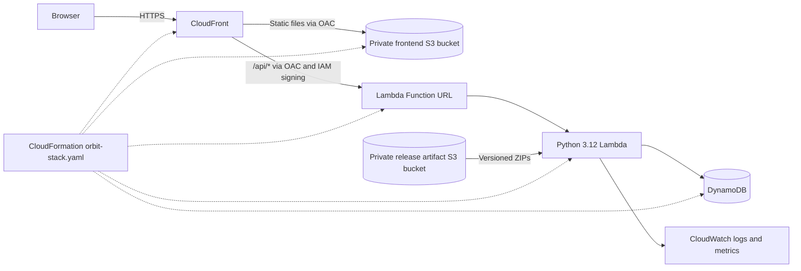

# Orbit — A Serverless Student Responsibility Management Platform

**CSE 4333 — Cloud Computing · University of Texas at Arlington**
**Team:** Robert Asumeng and Emily Ford

Orbit is an educational cloud computing project that brings academic, professional, personal, and collaborative responsibilities into one dashboard. It demonstrates serverless application development, AWS architecture, infrastructure as code, and repeatable deployment. It is a course prototype, not a production SaaS service.

## Features

- Dashboard, calendar, and task list for responsibilities.
- Task creation, categories, priorities, due dates, editing, and pending/completed status.
- DynamoDB persistence across refreshes and devices using workspace access codes.
- Personal workspaces and shared projects with invitation codes and assigned tasks.
- Manual `.ics` import from downloaded calendars, including Canvas exports. Imported events persist; re-importing skips unchanged events and updates changed titles or dates.

Orbit does **not** automatically synchronize with Canvas. UTA Canvas feed fetching from the Orbit browser origin was blocked by CORS; downloading and importing an `.ics` file remains the supported method.

## AWS architecture



CloudFront serves HTTPS, routes `/api/*` to the IAM-protected Lambda Function URL, and uses origin access controls for both origins. The browser receives static React files from private S3, then makes API requests through CloudFront. Lambda handles API and workspace operations and reads or writes DynamoDB records. DynamoDB conditional updates protect concurrent project membership changes. CloudWatch provides Lambda logs and metrics for troubleshooting. CloudFormation defines the unified stack; an existing IAM execution role and resource policies restrict AWS service access. A separate private S3 bucket holds versioned release artifacts.

## Technology stack

- Frontend: React 19, TypeScript 5.7, Vite 6 (see `frontend/package.json`).
- Backend: Python 3.12 Lambda, boto3, DynamoDB.
- Infrastructure: CloudFront, S3, Lambda Function URL, IAM, CloudFormation, and CloudWatch.

## Local development

Install Python 3.12 and Node.js/npm. From the repository root:

```powershell
cd frontend
npm ci
npm run dev
```

The frontend needs `VITE_API_URL` pointing to an accessible Orbit API. `frontend/.env.production` uses `/api` for the deployed CloudFront site. For local development, create an untracked `frontend/.env` with the URL of a local API proxy or other authorized test endpoint. `backend/app.py` is a Lambda handler, not a standalone local web server. The optional `backend/proxy.py` invokes an existing Lambda and requires locally configured AWS access and its dependencies in `backend/proxy-requirements.txt`; simply running Vite does not grant AWS access. Do not put credentials in frontend environment files.

## Deployment through the AWS Management Console

The authoritative infrastructure definition is `orbit-stack.yaml`. The older `template.yaml` and `orbit-frontend-template.yaml` are retained as historical split-stack templates; use the unified template for this deployment. The following Console workflow was used in AWS Academy Learner Lab. It requires no local AWS CLI configuration or copied temporary credentials.

### 1. Prepare release artifacts locally

From the repository root, run:

```powershell
.\scripts\package-release.ps1 -ReleaseId v4
```

The script runs `npm ci` and a production build, then validates the archives. It creates `artifacts/releases/v4/` containing `orbit-backend.zip` (`app.py` at ZIP root), `orbit-frontend.zip` (`index.html` at ZIP root), `orbit-stack.yaml`, and `release.json`. Generated archives are ignored by Git. If the `v4` directory already exists, use a new release ID; the packaging script will not overwrite it. Each new deployment should use a unique ID and matching S3 prefix.

### 2. Start AWS Academy Learner Lab

Start the sandbox, open its AWS Management Console, and select **us-east-1**. Confirm that the authorized Lambda execution role exists. Learner Lab resources can reset between sessions, so inspect the account before creating a stack.

### 3. Create a private artifact bucket

In **S3 → Create bucket**, choose a globally unique name in **us-east-1** and keep **Block Public Access** enabled. The bucket name is account-specific; do not copy a previous sandbox name. The execution role needs read access to release artifacts, plus DynamoDB and CloudWatch Logs permissions.

### 4. Upload the release

Create the folder/prefix `releases/v4/` in the artifact bucket and upload **all four** files from `artifacts/releases/v4/` into it. Check the exact S3 object keys, especially `releases/v4/orbit-backend.zip` and `releases/v4/orbit-frontend.zip`. Folder names are part of the keys referenced by CloudFormation.

### 5. Create the unified stack

Go to **CloudFormation → Create stack → With new resources (standard) → Upload a template file**. Select the packaged `orbit-stack.yaml`. Use a stack name such as `orbit-unified` and enter:

| Parameter | Example or purpose |
| --- | --- |
| `ArtifactBucket` | Your private bucket's name |
| `ArtifactVersion` | `v4` |
| `BackendZipKey` | `releases/v4/orbit-backend.zip` |
| `FrontendZipKey` | `releases/v4/orbit-frontend.zip` |
| `ExecutionRoleArn` | ARN of the existing authorized Lambda execution role in this account |
| `TableResourcePolicyEnabled` | `true` when DynamoDB table resource policies are permitted; otherwise `false` and grant equivalent table access to the execution role through its identity policy |

### 6. Configure stack options

The successful Learner Lab setup used no custom CloudFormation service role, standard deployment mode, normal rollback behavior, and deployment validations enabled. No extra notifications or stack policy were needed. Other AWS accounts may need different permissions or options. Review the proposed resource changes before submitting.

### 7. Deploy and verify

Submit the stack and watch its **Events** tab until `CREATE_COMPLETE`. CloudFront may take additional time to become available. In **Outputs**, open `WebsiteURL`. Visit `<WebsiteURL>/api/health`; it should return `{"status":"ok","service":"orbit"}`. Create a workspace and task, refresh to check persistence, and verify project listing and invitation-based collaboration.

### 8. Update an existing deployment

To upgrade from v3 to v4, or to a later release:

1. Package the new version with a **new** release ID.
2. Upload its four files under a matching new `releases/<release-id>/` S3 prefix.
3. In CloudFormation, select the existing stack and choose **Update stack**.
4. Replace the template with the new release's `orbit-stack.yaml`.
5. Set `ArtifactVersion`, `BackendZipKey`, and `FrontendZipKey` to the new release. Keep the existing stack name and execution role unless intentionally changing them.
6. Review the change set for unexpected replacements, especially the DynamoDB table, Lambda function, and CloudFront distribution.
7. Submit and wait for `UPDATE_COMPLETE`; repeat the health and application checks.

Unique artifact keys cause Lambda code and frontend assets to update reliably and keep older assets available for rollback. The table has `DeletionPolicy: Retain` and `UpdateReplacePolicy: Retain` to protect stored data. A future change requiring table replacement needs an explicit migration plan.

### 9. Troubleshooting and cleanup

- **Lambda `NoSuchKey`:** Compare the full S3 object key with `BackendZipKey`, including `releases/<release-id>/` and spelling. Correct the path and retry through a reviewed stack update.
- **Stack rollback:** Read CloudFormation Events and the affected Lambda's CloudWatch logs. Fix the cause and use a new release prefix when rebuilding. A retained DynamoDB table can remain after deletion or rollback and can prevent recreation with the same stack name; inspect it before trying again.
- **`Decimal is not JSON serializable`:** CloudWatch exposed this project-listing failure. The v4 backend now centrally serializes DynamoDB Decimal values; redeploying the corrected version in place resolved the observed failure.
- **Permissions:** If a table resource policy is blocked, set `TableResourcePolicyEnabled` to `false` and ensure the execution role has identity-policy access. Check artifact-bucket read permissions and CloudWatch Logs permissions as well.
- **Stale frontend:** Check `ArtifactVersion` and the frontend ZIP key, then allow CloudFront propagation. Cached old pages can still request prior release assets.

Deleting the stack removes its managed frontend and compute resources; the DynamoDB table is intentionally retained. Never delete a table containing important data as a routine rollback step. The artifact bucket and its uploaded releases are outside the stack and require separate cleanup. Recreating the same stack name after deletion may require adopting the retained table or using a different table name with a planned migration.

### 10. AWS Academy limitations

The sandbox can reset user-created resources. Git sync and CodeConnections were blocked by AWS Organizations permissions in this environment. Console upload and CloudFormation deployment were the reliable workflow for this project.

### Optional AWS CLI artifact publishing

For a separately configured AWS CLI, `scripts/publish-release.ps1` validates and uploads a packaged release to a private bucket under `releases/<release-id>/`. It prints the keys and template URL. This is optional and **does not** create or update the stack. The Console upload workflow above does not require it. Legacy deployment scripts remain in `scripts/` for reference and are not the unified release workflow.

## API and testing

The deployed API uses CloudFront's `/api` prefix. It provides health, workspace creation/opening, task listing/creation/editing/import, project listing/creation, and invitation-based joining. Workspace routes use `x-orbit-access-code`; due dates use timezone-aware ISO 8601 values.

Local checks from the repository root:

```powershell
.\venv\Scripts\python.exe -m unittest discover -s backend -v
python -m unittest discover -s scripts -p "test_*.py" -v
npm run build --prefix frontend
sam validate --lint --template-file orbit-stack.yaml --region us-east-1
```

Use an environment with the backend requirements installed if `venv` is absent. Packaging runs its own build and ZIP validation. These local checks do not prove AWS permissions or live behavior.

Observed project verification: initial stack creation and the v4 update reached `CREATE_COMPLETE` and `UPDATE_COMPLETE`; `/api/health` passed; task creation, refresh persistence, and completion passed; workspace creation and project listing passed; invitation collaboration worked; shared workspace data appeared on desktop and iPhone; manual `.ics` import brought in 21 events that persisted after refresh. All 16 backend tests passed after the Decimal fix. No load testing or performance measurements are claimed.

## Challenges and lessons learned

AWS Academy permissions and sandbox resets made reproducible CloudFormation packaging important. ZIP root layout and exact S3 keys affected deployment success. CloudFormation rollback and DynamoDB retention required careful data lifecycle review. CloudWatch helped isolate DynamoDB numeric serialization errors. IAM permissions had to permit artifact reads and DynamoDB operations while keeping frontend storage private. Versioned release assets and in-place stack updates helped preserve the working application and its data.

## Security and limitations

Orbit is an educational prototype and has not received a production security assessment. Workspace access codes are bearer secrets, not robust user authentication; avoid storing sensitive student data in the demonstration deployment. Manual `.ics` import is supported. Automatic Canvas synchronization was not implemented, and UTA Canvas browser fetching was blocked by CORS. AWS Academy resources may be temporary.

## Future enhancements

Potential work includes proper user accounts and authentication, secure Canvas integration and scheduled calendar synchronization, reminders and notifications, improved mobile responsiveness, and additional scalability and performance testing. These are not current capabilities.

**Repository:** [rasumeng/Orbit](https://github.com/rasumeng/Orbit)
